# BÁO CÁO ĐÁNH GIÁ MÔ HÌNH — YOLO26 Nhận diện gà broiler

_Tạo tự động bởi `training/chicken_detection/pipeline.py` — 2026-10-23 21:18:39_

## 1. Dữ liệu

- Tổng số id: **130** | hợp lệ: **130** | ảnh khớp nhãn: **130**
- Chi tiết từng mẫu: [`data_report.csv`](data_report.csv)
- Biểu đồ GĐ1:  |  |  |  | 

## 2. Kết quả huấn luyện (results.csv)

### yolo26n

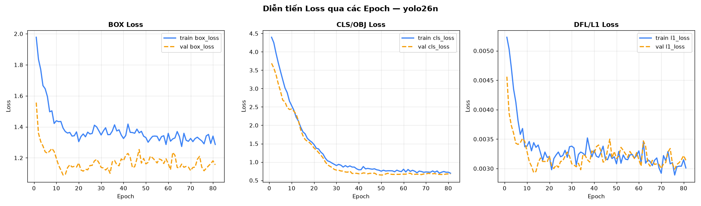

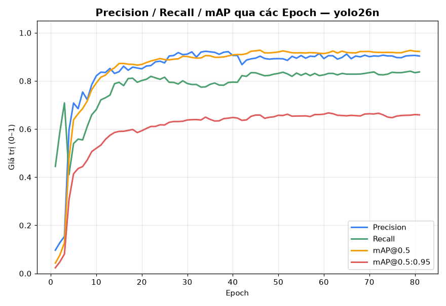

- Epoch cuối: 81 epochs, mAP50-95=0.659

### yolo26s

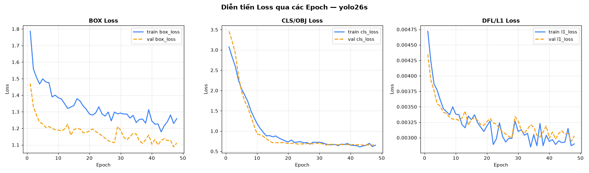

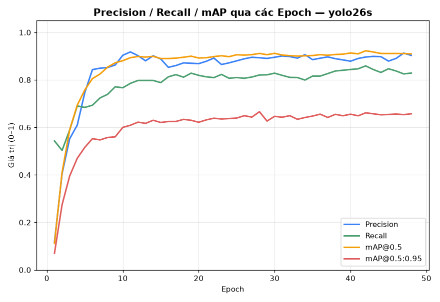

- Epoch cuối: 48 epochs, mAP50-95=0.657

## 3. Detection Metrics (test set, benchmark thủ công)

| Model | TP | FP | FN | Precision | Recall | F1 | mAP@0.5 | mAP@0.5:0.95 |
|---|---|---|---|---|---|---|---|---|
| yolo26n | 341 | 34 | 39 | 0.909 | 0.897 | 0.903 | 0.889 | 0.646 |
| yolo26s | 352 | 38 | 28 | 0.903 | 0.926 | 0.914 | 0.914 | 0.663 |

**yolo26n**

| IoU | GIoU | DIoU | CIoU | SIoU |
|---|---|---|---|---|
| 0.851 | 0.848 | 0.849 | 0.849 | 0.536 |

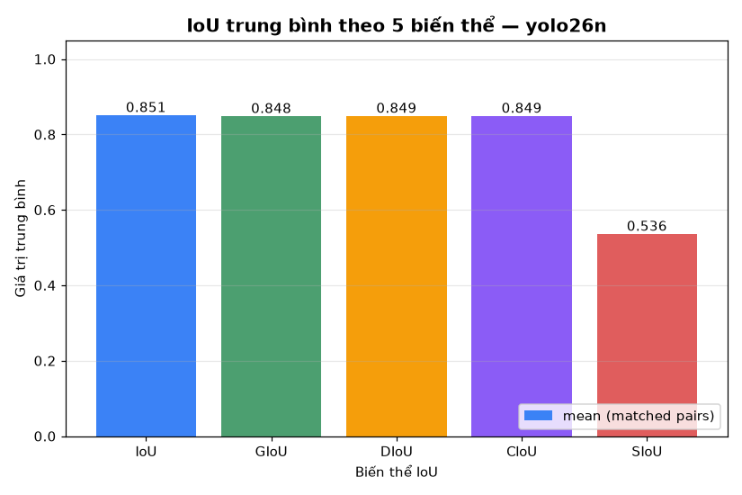

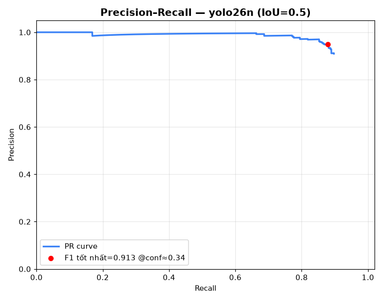

**yolo26s**

| IoU | GIoU | DIoU | CIoU | SIoU |
|---|---|---|---|---|
| 0.855 | 0.852 | 0.853 | 0.853 | 0.531 |

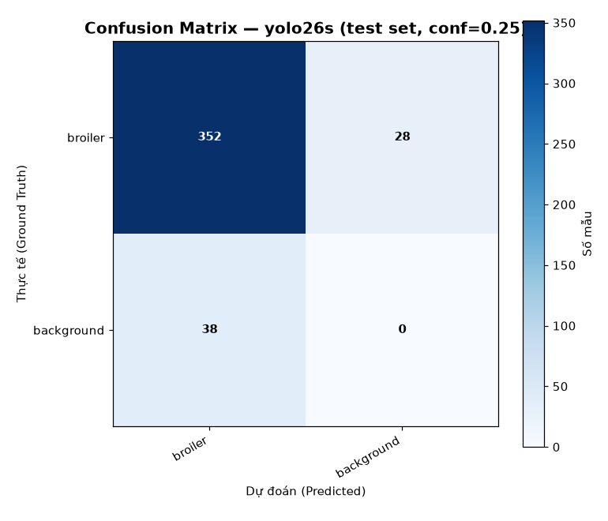

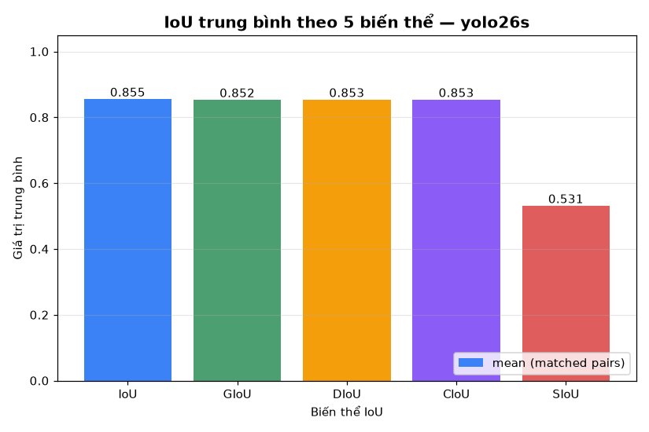

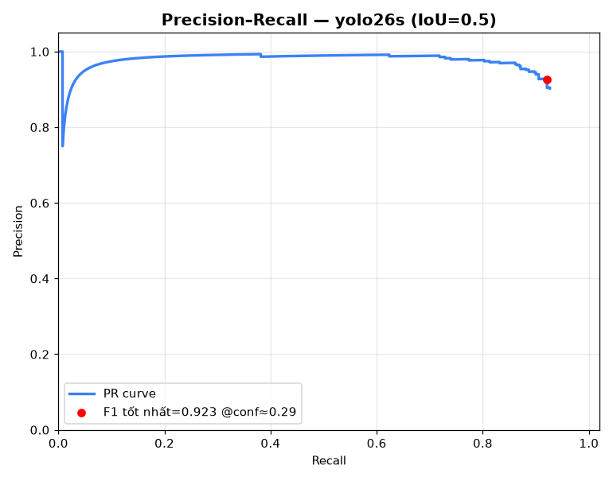

## 4. Speed & Latency

**yolo26n** — 180 ảnh (warmup 20): pre 1.94 ms | infer 9.84 ms | post 1.67 ms | **tổng 13.46 ms → 74.3 FPS**

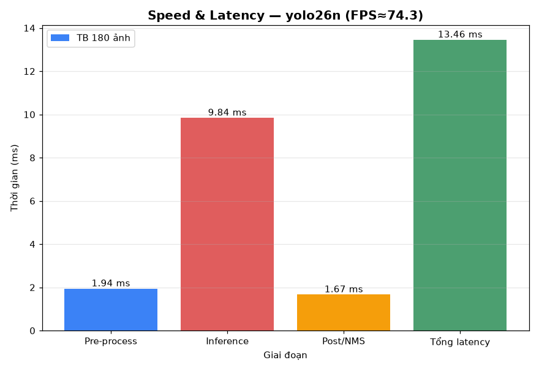

**yolo26s** — 180 ảnh (warmup 20): pre 1.78 ms | infer 9.57 ms | post 1.53 ms | **tổng 12.87 ms → 77.7 FPS**

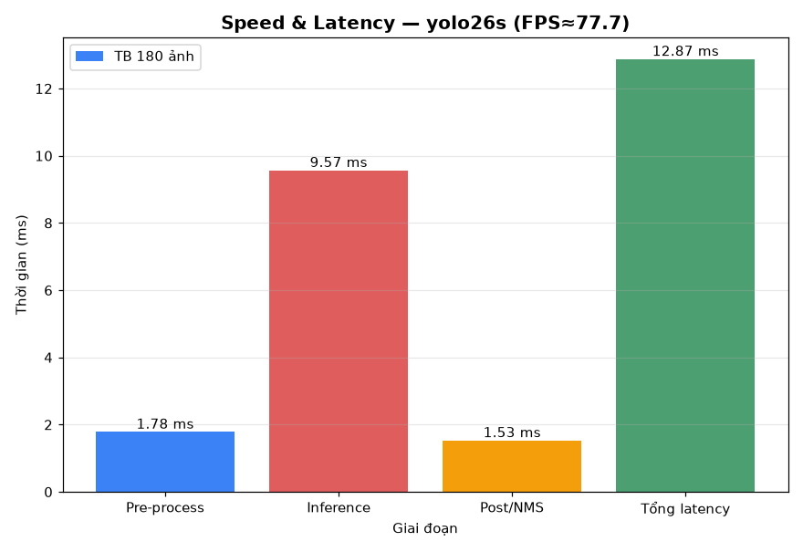

## 5. Complexity & Tài nguyên

| Model | Params | GFLOPs | Weights (MB) | Peak RAM % | Peak VRAM MB |
|---|---|---|---|---|---|
| yolo26n | 2,533,886 | 6.03 | 5.2 | 61 | 4091 |
| yolo26s | 9,948,638 | 22.74 | 19.4 | 63 | 4089 |

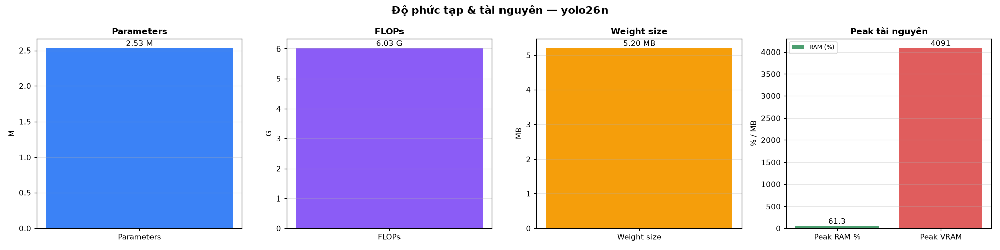

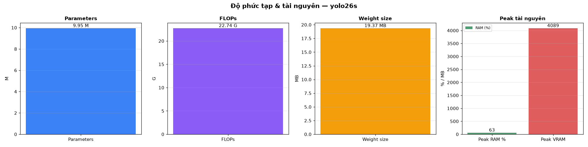

## 6. Ghi chú

- Dataset: `Chicken.v2-wideangle_yewon_v2` (Roboflow, CC BY 4.0) — nhãn gốc POLYGON, đã convert → bbox, chỉ mẫu hợp lệ đưa vào train.
- Augmentation động (xám/đèn ấm/nhiễu) áp dụng theo xác suất lúc train, không ghi đè ảnh gốc.
- YOLO26 (hệ v8+) không còn nhánh objectness riêng; loss = box + cls + l1.
- AP tính theo all-point interpolation; mAP@0.5:0.95 trung bình IoU 0.5→0.95 bước 0.05; detections lọc conf≥ngưỡng eval.
- SIoU = IoU − (Λ + Δ + Ω)/2 (Tong et al., 2023).
- Log tài nguyên: [`system_performance_log.csv`](system_performance_log.csv)
