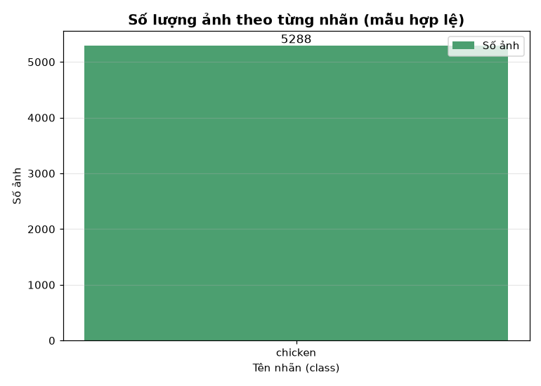
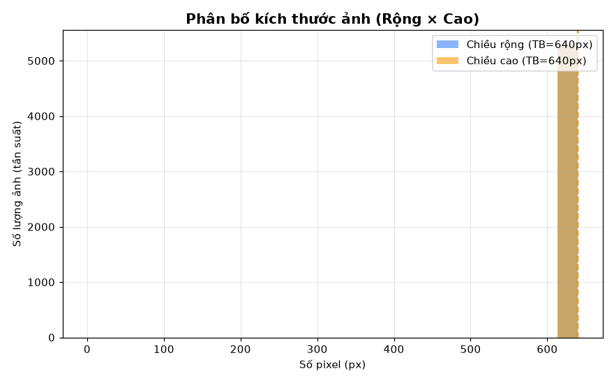
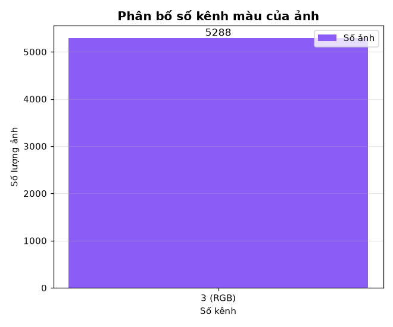
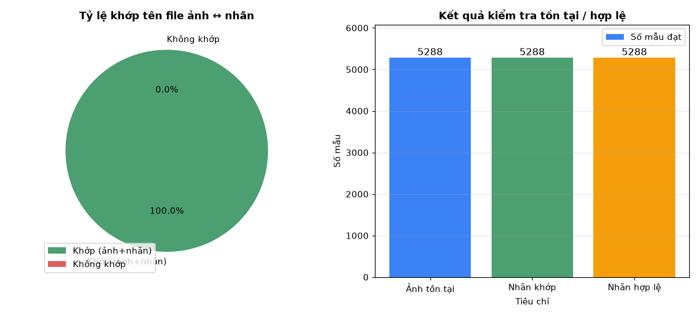
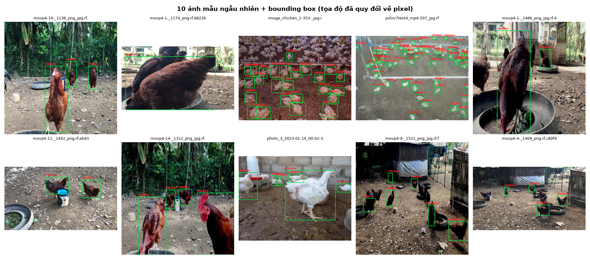

# BÁO CÁO ĐÁNH GIÁ MÔ HÌNH — YOLO26 Nhận diện gà (chicken)

_Tạo tự động bởi `training/chicken_detection/pipeline.py` — 2026-10-31 06:56:33_

## 1. Dữ liệu

- Tổng số id: **5288** | hợp lệ: **5288** | ảnh khớp nhãn: **5288**
- Chi tiết từng mẫu: [`data_report.csv`](data_report.csv)
- Biểu đồ GĐ1:  |  |  |  | 

## 2. Kết quả huấn luyện (results.csv)

### yolo8n

### yolo8s

## 3. Detection Metrics (test set, benchmark thủ công)

_Chưa có kết quả — chạy `--stage eval` sau khi train.

## 4. Speed & Latency

## 5. Complexity & Tài nguyên

| Model | Params | GFLOPs | Weights (MB) | Peak RAM % | Peak VRAM MB |
|---|---|---|---|---|---|

## 6. Ghi chú

- Dataset: `Chicken.v2-wideangle_yewon_v2` (Roboflow, CC BY 4.0) — nhãn gốc POLYGON, đã convert → bbox, chỉ mẫu hợp lệ đưa vào train.
- Augmentation động (xám/đèn ấm/nhiễu) áp dụng theo xác suất lúc train, không ghi đè ảnh gốc.
- YOLO26 (hệ v8+) không còn nhánh objectness riêng; loss = box + cls + l1.
- AP tính theo all-point interpolation; mAP@0.5:0.95 trung bình IoU 0.5→0.95 bước 0.05; detections lọc conf≥ngưỡng eval.
- SIoU = IoU − (Λ + Δ + Ω)/2 (Tong et al., 2023).
- Log tài nguyên: [`system_performance_log.csv`](system_performance_log.csv)
